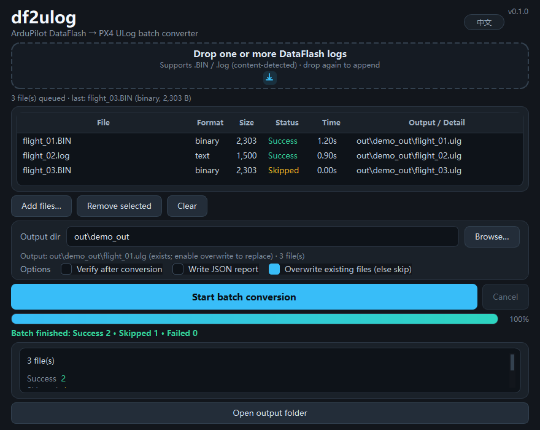

# df2ulog

[](https://github.com/BingDouhua612/df2ulog/actions/workflows/ci.yml)
[](LICENSE)

**English** · [简体中文](README.md)

Convert ArduPilot DataFlash logs (`.BIN` / Mission Planner `.log`) to **PX4 ULog** (`.ulg`) for PlotJuggler and `pyulog`. Ships a CLI and a Windows GUI with batch conversion.



## Install

```bash
git clone https://github.com/BingDouhua612/df2ulog.git
cd df2ulog
python -m venv .venv && source .venv/bin/activate   # Windows: .venv\Scripts\activate
pip install -e ".[verify]"                          # GUI: pip install -e ".[gui]"
```

## Usage

```bash
df2ulog logs/flight.BIN -o out/flight.ulg --verify
df2ulog logs/flight.log -o out/flight_text.ulg      # text log (content-detected)
df2ulog inspect logs/flight.BIN --limit 20          # stats only
df2ulog verify out/flight.ulg --source logs/flight.BIN
```

Common options: `-o/--output`, `--force`, `--verify`, `--report/--report-json`, `--strict`, `--allow-time-reset`.
Exit codes: `0` OK / `3` invalid input / `4` conversion failed / `5` verify failed / `6` output exists.

**GUI**: run `df2ulog-gui`, drop one or more logs, then click "Start batch conversion". Supports cancel-remaining, skip-existing (default) and per-file status/elapsed time with a batch summary. Use the **EN / 中文** button in the top-right to switch the UI language (the choice is persisted).

## Docs

- [GUI guide](docs/GUI.md)
- [Format notes](docs/FORMAT-NOTES.md) · [Field mapping](docs/MAPPING.md)
- [Design decisions](docs/DECISIONS.md)

## Development

```bash
pip install -e ".[dev]"
ruff check src tests
pytest -q -m "not real"        # real-log tests: see CONTRIBUTING.md
```

## License

[MIT](LICENSE). Third-party licenses: [THIRD_PARTY_NOTICES.md](THIRD_PARTY_NOTICES.md).
