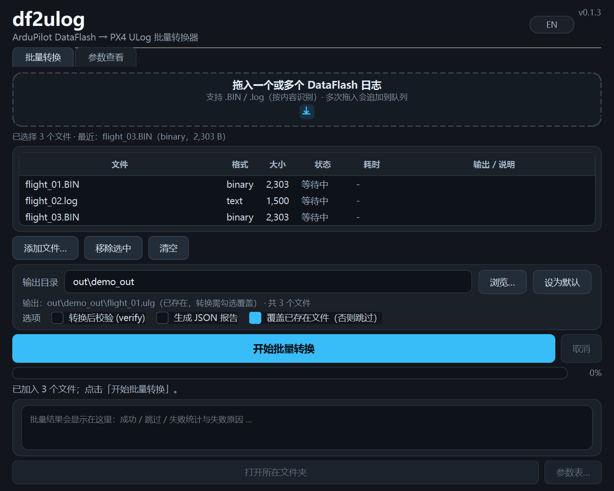
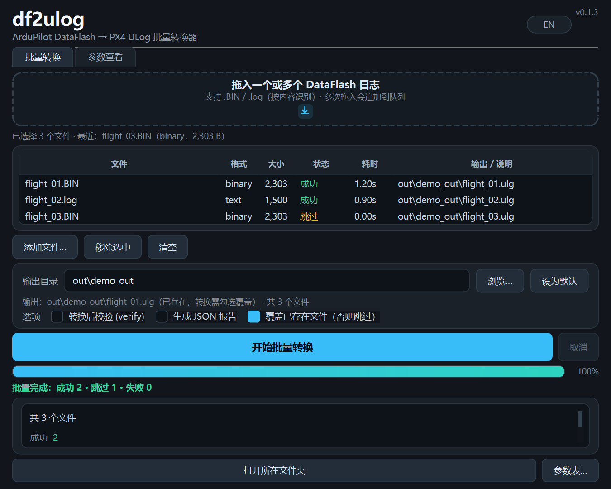
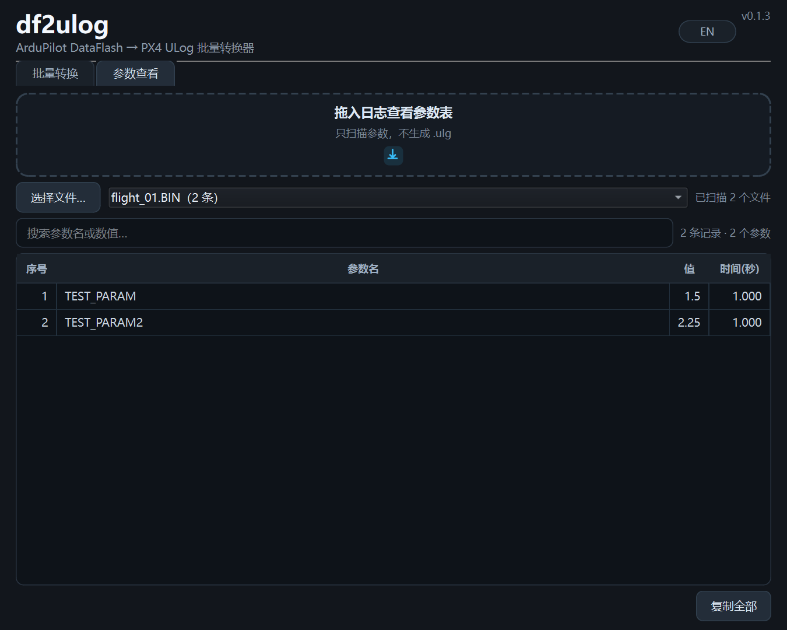

# df2ulog 图形界面（GUI）

> 内核与 CLI 完全相同（同一份 `.ulg` 字节）；测试说明见 [CONTRIBUTING.md](../CONTRIBUTING.md)。

## 启动

```powershell
python -m pip install -e ".[gui]"
df2ulog-gui            # 或：python -m df2ulog.gui
```

依赖：`pip install -e ".[gui]"`（PySide6）。

## 界面风格（深色专业风，2026-10-18 改版）





- **深色专业工具风**：Fusion 基础样式 + 自定义 QSS（深灰蓝底 `#12161c`、卡片 `#1a2129`、青蓝强调色 `#38bdf8`、圆角 8–14 px、细边框、渐变进度条）。
- 顶部品牌区 + 拖拽卡片（矢量下载图标，拖入时边框高亮为强调色）+ 文件信息条。
- 输出卡片：输出目录、**实时"输出：…文件"预览**（目标已存在时提示需勾选覆盖）、verify/报告/覆盖选项。
- 主操作：高亮大按钮；进度条 + 百分比 + 阶段文字；结果卡片用"标签 / 值"排版，verify PASS/FAIL 用绿/红徽标。
- 中文字体 `Microsoft YaHei UI`，高 DPI 自适应；布局按 1080p/150% 缩放下 820×720 逻辑像素调优，关键信息无需滚动。
- 无外部图片资源依赖（图标均 QPainter 矢量绘制，打包无额外素材）。

## 界面语言

右上角 **EN / 中文** 按钮一键切换中英文界面；选择通过 `QSettings` 记住，下次启动保持上次语言（默认中文）。

## 默认输出目录

输出目录输入框右侧有一个 **「设为默认」** 按钮（可切换）：

- 点击（勾选）→ 把当前输出目录存为**默认目录**，以后每次启动 GUI 自动填入；
- 再次点击（取消）→ 清除默认目录，回退到「各文件所在目录」或上次使用的目录；
- 临时在输入框里改目录**不会**影响已保存的默认值；
- 若当前目录为空，点击会提示先选择/填写目录；
- 默认值保存在 `QSettings("df2ulog", "df2ulog-gui")` 的 `default_output_dir`，不写注册表以外的文件。

## 参数查看

窗口顶部有两个标签页：**批量转换** / **参数查看**。

**参数查看**（独立页面，不需要转换）：

- 把 `.BIN` / `.log` 拖入虚线区，或点「选择文件…」；
- 后台只扫描元数据/PARM（**不生成 `.ulg`**），大日志也比完整转换快很多；
- 表格列出全部 PARM 变更：序号 / 参数名 / 值 / 时间（秒）；
- 一次可加入多个日志，顶部下拉框切换查看；
- 支持搜索过滤、多选行、**「复制全部」**（Tab 分隔，可直接粘贴进 Excel）。



转换完成后，**批量转换** 标签页底部也有 **「参数表…」** 按钮，弹窗查看本次转换各文件的参数（批量时用下拉框切换文件）。

## 界面与操作（批量转换）


1. **添加文件**：把一个或多个 `.BIN`/`.log` 拖入上方虚线区域（多次拖入会追加）；或点"添加文件…"多选。按内容识别格式，不依赖扩展名；无法识别的文件显示为"无效"并标红，不参与转换。
2. **队列表格**：逐行显示 文件 / 格式 / 大小 / 状态 / 耗时 / 输出或错误；可"移除选中"或"清空"。
3. **输出目录**：留空 = 每个文件输出到**各自所在目录**；选择目录 = 全部输出到该目录。文件名默认 `<源文件名>.ulg`。下方实时预览首个输出路径（已存在时提示需勾选覆盖）。
4. **选项**：
   - `转换后校验 (verify)`：对每个输出执行 lint + pyulog 回读 + 源文件全量重放比对（批量会明显变慢）；
   - `生成 JSON 报告`：每个输出旁生成 `<名字>_report.json`；
   - `覆盖已存在文件（否则跳过）`：默认**跳过**已存在的输出（该行标记"跳过"并继续），勾选后覆盖。
5. **开始批量转换**：后台线程**顺序**转换（避免并行争抢 CPU/磁盘），总进度 + 当前文件阶段进度，窗口不假死；单个文件失败/verify 失败只标记该行，继续后续。
6. **取消**：批量进行中点"取消"——当前文件会完成，后续排队文件标记"已取消"，已完成结果保留。
7. **结果**：表格逐行显示 `成功 / 跳过 / 失败 / 已取消` + 耗时 + 输出路径；底部汇总"成功 N · 跳过 M · 失败 K"，失败原因在详情面板列出。
8. **打开所在文件夹**：有成功输出后可用。
9. 窗口会记住上次输出目录（`QSettings`）。

## 错误码## 错误码

| 码 | 含义 | 常见原因 |
|---|---|---|
| 3 | 输入无效/不可读 | 文件不存在、不是 DataFlash 日志 |
| 4 | 转换失败 | 未知格式字符、无数据 topic、时间大回退（可用 CLI `--allow-time-reset`） |
| 5 | verify 失败 | 输出与源不一致（转换 bug 或文件被改） |
| 6 | 输出已存在 | 勾选"覆盖已存在文件"或换目录 |

## 已知限制（v1）

- 批量转换是**顺序**执行（不做并行，避免争抢 CPU/磁盘）；取消不会打断正在转换的当前文件，只停止后续排队文件。
- 无法在 GUI 中设置 `--allow-time-reset`/`--strict`/`--params none` 等高级选项（用 CLI）。
- 未签名 exe 首次运行可能被 SmartScreen 提示；需要正式分发时再签名。
- GUI 不改变 `.ulg` 内容：同一输入+选项，GUI 生成结果与 CLI 逐字节一致。

## 故障排查

| 现象 | 处理 |
|---|---|
| 拖拽无反应 | 用"选择文件…"按钮（部分远程桌面/权限环境拖拽事件被系统拦截） |
| 启动报缺 Qt 插件 | 确认 `pip install -e ".[gui]"` 成功；打包版请使用 `dist\df2ulog-gui\` 整个目录 |
| 转换失败（错误码 4） | 看弹窗消息；可先用 CLI `df2ulog inspect`/`df2ulog verify` 排查 |
| verify 很慢 | 42 MB 日志 verify 约 +10 s 属正常；不需要时取消勾选 |
| 输出文件被占用 | 关闭正在打开该 `.ulg` 的程序（如 PlotJuggler）后重试 |

## 打包（免 Python 运行，onedir，可选）

前置：已安装 GUI 开发依赖（`python -m pip install -e ".[gui-dev]"`）。

```powershell
.\scripts\build_gui.ps1                                   # 构建 + 基础冒烟
.\scripts\build_gui.ps1 -SmokeLog D:\logs\flight_01.BIN   # 额外做 --selftest 冒烟
.\dist\df2ulog-gui\df2ulog-gui.exe
```

- 产物：`dist\df2ulog-gui\`（onedir，约 250 MB）；分发时压缩整个目录，目标机无需 Python。
- 冒烟：`--version`、GUI 进程启动存活；提供 `-SmokeLog` 时额外做无头转换自检。
- PyInstaller 构建日志偶见 Windows 文件占用重试（杀软/索引），自动重试成功后忽略即可。
- 未签名 exe 首次可能被 SmartScreen 提示。
- 对外分发打包产物时请遵守 [THIRD_PARTY_NOTICES.md](../THIRD_PARTY_NOTICES.md) 中 PySide6 / pymavlink 的 LGPL 条款。

## 发布前自查

1. `ruff check src tests`、`pytest -q -m "not real"` 通过。
2. 本机执行 `scripts/build_gui.ps1 -SmokeLog <本地日志>` 并保留输出。
3. 测试与贡献说明见 [CONTRIBUTING.md](../CONTRIBUTING.md)。
